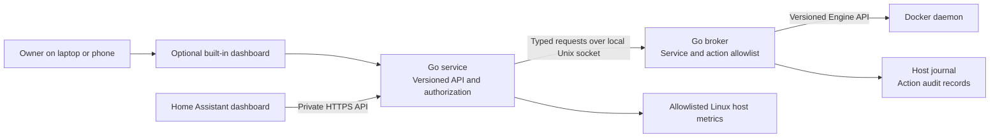

# Home Server Manager rewrite

**Status** Proposed design and implementation plan, November 24, 2026

## Goal

Build a private operations dashboard for a single Docker home server. From a laptop or phone, the owner should be able to tell what is healthy, see where disk space is going, and safely restart an approved service. The dashboard should take little memory, install without a Python or Node runtime, and stay out of the way when the Docker daemon or dashboard is unavailable.

The Go service must work with its built-in interface disabled. Home Assistant can display host and service health and invoke approved actions through a versioned API, so its dashboard can become the owner's main interface.

The existing dashboard exposes useful Compose controls for one stack. Its shipped image is about 166 MB, the update action fails before the pull, and the Flask app serves unauthenticated management routes with direct Docker socket access. The current deployment is stopped, and the managed services continue to run. [Deployed backend source](https://github.com/bises/home-server-manager/blob/15dae57dc682afec9e35874cebe948c7c0b0846a/app.py) · [Deployment README](../../README.md)

A targeted Flask patch could close the access and update issues with less work. The rewrite adds a responsive host overview, separates the web app from Docker privileges, and gives one small service a clear contract. It costs more up front and should ship in independently useful stages.

## Feature scope

| Priority | Scope | Outcome |
| --- | --- | --- |
| Now | Host overview with disk, memory, load, uptime, service health, and last refresh time | See what needs attention when opening the dashboard. |
| Now | Service list grouped by stack with search, status filters, image tag, published ports, and configured links | Find a service quickly and reach its own interface. |
| Now | Activity history for dashboard actions. Add explicit start, stop, and restart for allowlisted services after the read-only pilot. | Verify who changed a service, what changed, and whether it recovered. |
| Now | Versioned API and a Home Assistant example with health tiles and a confirmed restart button | Manage the same approved services from Home Assistant with the standalone UI disabled. |
| Experiment | Bounded recent logs for approved services and a phone-friendly, private tailnet entry point | Diagnose routine failures from a phone while keeping the access surface narrow. |
| Later | Image and disk cleanup previews, guided updates, and a rollback flow | Review the target, expected result, and dependencies before changing the server. |
| Reject | The OpenClaw panel, anonymous control endpoints, arbitrary Compose paths and shell commands, and automatic container updates | Keep the interface focused on supported operations. |

Keep container status, health, ports, and manual controls from the current app. Move service creation, removal, and image updates out of the first release. An update flow needs a preview and should preserve a stopped service's intended state. Protected services such as databases start as view-only until the owner explicitly enables individual actions.

## Interface

Use a restrained operations layout with **Overview**, **Services**, and **Activity**. The Overview opens with the host name, the last successful refresh, and a concise health summary. Put disk space and active problems in the first screen on a phone. Use color alongside a status word and icon, with readable contrast and keyboard-visible focus.

- **Overview** shows disk use by configured mount, memory and load, and services needing attention. Backup mounts and root storage have separate labels. Each alert links to the affected service or metric.
- **Services** shows a compact table on desktop and stacked cards on narrow screens. A service detail view shows the health check, last state change, image and ports. Keep frequent actions visible and place rarely used controls in a menu.
- **Activity** shows who initiated a dashboard action, the target, the result, and its time. Show when the result is still being verified.
- **Failure states** distinguish stopped, unhealthy, starting, and unknown. When the latest refresh fails, show the last known state with its age. Disable changes when the target or current state cannot be verified.
- **Action flow** names the service and warns about the expected disruption before a stop or restart. Show one pending action per service and refresh its status after the command completes. If the outcome is unclear, show that state and re-read Docker before offering a retry.

Build the first interface with Go HTML templates, CSS, and a small amount of vanilla JavaScript for refresh and action feedback. Forms and navigation should remain usable without JavaScript. Bundle fonts and other assets locally where needed. This keeps the runtime small and makes the UI easier to maintain alongside the backend.

## Architecture

Use **Go** for a single Linux binary with two modes. The HTTP service exposes the versioned API and can also serve an optional built-in dashboard. Both interfaces use the same service and authorization logic. The broker owns the Docker connection and serves a small local Unix socket API. The HTTP service account has no Docker group membership. The broker loads a host-owned allowlist of projects, services, and actions. Only the HTTP service account can connect to the broker's socket.

Use the versioned Docker Engine API for reads and basic container actions. Negotiate the supported version and fetch a snapshot of managed containers once per refresh interval. The broker resolves the container from the approved Compose project and service labels on the server and returns only fields the UI needs. Fetch detailed health and timestamps when an operator opens a service. Keep host metrics and snapshot freshness visible even when Docker returns an error. Use host configuration and the system journal in the first release. Add persistent application storage only if a later feature requires it. [Docker Engine API](https://docs.docker.com/reference/api/engine/)

For future image changes and recreates, use Docker Compose through the broker with explicit host-configured projects and commands. Compose remains responsible for applying the project definition and resolving service dependencies. The UI should show the pinned tag or digest, the affected containers, and the expected transitions before a change. [Docker Compose CLI](https://docs.docker.com/reference/cli/docker/compose/)

### Home Assistant integration

The Go service and broker stay on the Docker host. Home Assistant can run on that host or another machine. Set the manager's base URL, provision scoped credentials, and map stable service IDs to the entities and buttons the owner wants. A service ID comes from the manager's configuration and stays the same when Docker replaces a container.

| API contract | Home Assistant use |
| --- | --- |
| `GET /api/v1/snapshot` | One read-only poll for disk, memory, uptime, and selected service states. Include a sample time and freshness so an unavailable or stale reading appears as such. Return sizes in bytes and timestamps in UTC. |
| `POST /api/v1/services/{id}/actions/{verb}` | A named script submits one approved action for one configured service. A successful submission returns an operation ID and an accepted state. |
| `GET /api/v1/operations/{id}` | The script checks for completion within a bounded timeout. It distinguishes verified success, failure, and an unknown outcome before asking the operator to check current service state. |

Ship an example using Home Assistant's built-in RESTful integration to create several sensors from one snapshot. Use a REST Command inside a named script for each enabled action. Configure the dashboard button to call the script and show a confirmation for actions such as restart. Home Assistant can read the command response in the script, so accepting a request can be shown separately from a confirmed restart. [RESTful integration](https://www.home-assistant.io/integrations/rest/) · [REST Command](https://www.home-assistant.io/integrations/rest_command/) · [Dashboard actions](https://www.home-assistant.io/dashboards/actions/)

Use private HTTPS with certificate verification and a revocable machine credential stored in Home Assistant's secrets. Give sensors read-only access. Issue an independent action credential scoped to the small set of service IDs and verbs the owner enables. Keep the Docker socket and broker off the Home Assistant network path. The server records Home Assistant as the actor for its machine credential. Keep controls for Home Assistant itself off its dashboard until an independent recovery path is available.

### Access and safety

- Run the initial read-only preview on loopback through SSH. To connect Home Assistant or a remote browser, use HTTPS and an access policy for approved clients. Browser actions require an authenticated session. Machine actions require a credential scoped to the requested service and verb. The authentication provider and remote access topology are deployment decisions.
- Use viewer and operator roles. Use secure session cookies and CSRF protection for browser sessions, and accept changes through explicit POST actions. Deny requests with untrusted identity or missing authorization.
- Treat the Docker socket as privileged host access. Give it only to the broker. The broker validates the requested service and verb against its own allowlist before reaching Docker. It uses a narrow set of operations and rejects ambiguous targets. [Protect the Docker daemon socket](https://docs.docker.com/engine/security/protect-access/)
- Keep access checks at the network, web session, and broker boundaries. For a Tailscale Serve deployment, set a narrow tailnet access policy and keep the app's authorization. Serve identity headers only describe requests received through that proxy, and a device share can include other tailnet users. [Tailscale Serve](https://tailscale.com/docs/features/tailscale-serve#identity-headers)
- Keep stored configuration, metrics and audit records local. Log actor, service, action, time, and outcome. Limit operational logs returned to the browser and keep environment variables and credentials out of responses. Pin and review release inputs and dependencies in CI.

## Implementation plan

| Phase | Deliverable | Exit check |
| --- | --- | --- |
| 0. Scope and fixtures | Inventory current workflows, select the pilot services and access model, and create a disposable Compose fixture with running, stopped, and unhealthy services. | The service list, protected actions, and intended laptop and phone workflows are agreed. Baseline the old app in the fixture. |
| 1. Read-only API and dashboard | Build the versioned snapshot API, broker, host metrics, and responsive templates. Add an API-only configuration and test Home Assistant sensors against the fixture. Ship a loopback-only preview on a new port. | Verify status and ports against Docker, stale and unavailable states, keyboard navigation, and a narrow-phone layout. Home Assistant can read the same snapshot with the UI disabled. The broker denies changes during the pilot. |
| 2. Authenticated controls | Add browser sessions, scoped machine credentials, start, stop, restart, and journal audit records. Add the Home Assistant script and button example. | Test role and scope denial, browser CSRF protection, concurrent requests, timeouts, and recovery. With the built-in UI disabled, verify that a Home Assistant button can restart an approved fixture service and confirm its outcome. |
| 3. Pilot on the home server | Install the binary and service definitions under separate accounts. Start with a small allowlist and configure private HTTPS for Home Assistant access. | Check laptop and phone use, machine credentials, and Home Assistant running on a separate host or network address. Existing application endpoints stay healthy. Rolling back the pilot only stops the manager service and broker. |
| 4. Validate further features | Try bounded logs, cleanup previews, and Compose-based updates in that order, using the needs found during the pilot. | A feature ships after it has a clear operator workflow, handles partial failures, and demonstrates its rollback or recovery path on the fixture. |

Proposed performance targets are a stripped Linux binary under 15 MB, combined idle memory under 50 MiB for the dashboard and broker, and p95 cached reads under 300 ms for a stack of 20 containers. Measure these on the pilot hardware with the same fixture used for the baseline. Validate the owner can spot an unhealthy service on a phone and restart an approved service with a clear result in Activity.

Pause rollout if the HTTP service or the Home Assistant integration can access the managed host's Docker socket directly, an unauthorized action reaches the broker, a failed refresh mislabels a service as down, or the pilot changes an unrelated service. Keep the old deployment stopped during the pilot.
